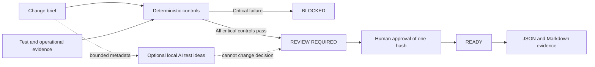

# AI Delivery Gate

**A review-first release-readiness prototype for AI-assisted software delivery.**

Python 3.12 · Streamlit · Optional local Ollama · MIT application code

## Why this exists

AI can shorten implementation time, but faster code does not remove the need for a clear outcome, test evidence, data review, rollback planning, monitoring and accountable human approval. This prototype turns those requirements into a visible release decision.

It is a new portfolio project. It does not connect to an employer repository, inspect source code, deploy software or grant production access.

## What works

- Structured change brief with outcome, scope, risk, data classification and testable acceptance criteria.
- Eleven deterministic controls across definition, quality, data and security, operations and ownership.
- Critical controls that block release; a readiness score cannot override them.
- Risk-aware peer-review and data-review requirements.
- Exact-version approval using a SHA-256 fingerprint; any brief or evidence change invalidates approval.
- JSON evidence bundle and Markdown review export after approval.
- Optional local-AI suggestions for additional negative, boundary and recovery tests.
- AI receives bounded brief metadata only and cannot alter the gate result or approve a release.

## Run locally

```bash
python3.12 -m venv .venv
source .venv/bin/activate
python -m pip install -r requirements.txt
python -m streamlit run app.py --server.address 127.0.0.1
```

No paid API or account is required. The release gate is deterministic and works without a language model.

### Optional local AI

Install [Ollama](https://ollama.com/download), install a compatible local model and enable it in the sidebar. The adapter calls only `http://127.0.0.1:11434/api/chat`. It receives the title, business outcome, risk level, data classification, changed-area labels, acceptance criteria and failed-control IDs. It does not receive source code, credentials, rollback details or production data.

## Two-minute walkthrough

1. Review the default change brief and delivery evidence.
2. Open **Gate decision** and inspect why the version needs review rather than being immediately ready.
3. Set one automated test to failed. The decision becomes **BLOCKED** and approval is disabled.
4. Restore the test result, enter a reviewer and approve the packet.
5. Download the JSON or Markdown evidence report.
6. Change the business outcome. The earlier approval becomes invalid and exports lock.

## Decision model



| Decision | Reason | Trade-off |
|---|---|---|
| Deterministic controls own the verdict | The same evidence produces the same result | The demo does not inspect whether evidence is truthful |
| Critical failures override the score | Prevents an average score from hiding a release blocker | Control severity must be governed in production |
| Approval binds to a packet hash | A material edit requires a new review | Demo identity is session-only |
| AI proposes tests only | Useful assistance without granting release authority | Suggestions still need human selection and execution |
| No repository or deployment connector | Safe portfolio demonstration | Production integration remains future work |

## Testing

```bash
python -m unittest discover -s tests -v
```

Tests cover critical and advisory controls, risk-dependent requirements, inconsistent evidence, approval rules, change invalidation, exports, AI data minimization, structured-output validation, loopback-only model access and Streamlit interactions. See [validation evidence](docs/VALIDATION.md).

## Limits

- Checkbox evidence is user supplied; this demo does not verify CI logs, review signatures, scanners or deployment systems.
- The readiness score is descriptive. Governance owners must define and maintain real controls and exceptions.
- SHA-256 binds the exported packet content; it does not authenticate the reviewer.
- The reviewer label and approval live only in the Streamlit session.
- AI-generated test ideas are unverified and are never counted as executed tests.
- There is no database, identity provider, source-control write access, deployment trigger, feature-flag service or production monitoring integration.

## Product ownership and provenance

This project was newly developed with AI assistance for Senan Dasdemir's portfolio. Senan supplied the product direction: demonstrate how delivery speed can increase while test evidence, operational controls and human accountability remain visible. It is not copied employer code or a renamed third-party product. Dependencies and limits are disclosed.

## Türkçe kısa açıklama

AI destekli geliştirilen bir değişikliğin canlıya çıkış hazırlığını; kabul kriterleri, test sonuçları, veri güvenliği, geri dönüş planı, izleme ve insan onayı üzerinden değerlendirir. Kritik bir kontrol başarısızsa yayını bloke eder. Her değişiklik önceki onayı geçersiz kılar. Herhangi bir yazılımı canlıya almaz.

## License

New application code: [MIT](LICENSE). Streamlit is used under Apache-2.0; optional Ollama and model weights retain their own licenses.
